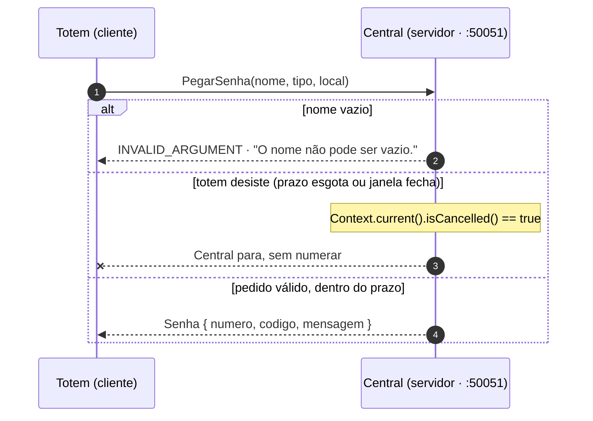

<div align="center">

# Central de Senhas · gRPC

Totens pedem uma senha a uma Central por gRPC.<br>A Central numera, valida o pedido e percebe quando o totem já desistiu de esperar.


[Rodar](#passo-a-passo-rodar-testar-e-encerrar) ·
[Arquitetura](#arquitetura) ·
[Decisões](#decisões-de-projeto) ·
[Contrato](#contrato-grpc) ·
[Trabalho 5](#trabalho-5--falhas-deadline-e-validação) ·
[Apresentação](#apresentação) ·
[Prompts](PROMPTS.md)

<sub>Trabalho 5 · Sistemas Paralelos e Distribuídos · Profª Madianita Bogo Marioti · CEULP/ULBRA, Palmas-TO</sub>

</div>

```bash
# dois terminais, um em cada pasta
cd ServidorAtendimentoRPC && mvn exec:java -Dexec.mainClass=com.mycompany.servidoratendimentorpc.ServidorAtendimentoRPC
cd ClienteAtendimentoRPC  && mvn exec:java -Dexec.mainClass=com.mycompany.clienteatendimentorpc.ClienteAtendimentoRPC
```

---

## Objetivo

Implementar a Central de Senhas da aula de gRPC e, como Grupo 5, acrescentar o que faltava para o sistema se comportar bem quando um pedido está errado ou quando ninguém mais está esperando a resposta: **validação** e **deadline/cancelamento**.

### O contexto

Vários totens, espalhados pela faculdade (Biblioteca, Central de Relacionamento, Financeiro), pedem uma senha numerada para uma única Central, por uma chamada gRPC. A Central garante que dois totens nunca recebam o mesmo número, mesmo pedindo ao mesmo tempo.

O projeto base (passos 1 a 8 da aula) cobre o caminho feliz: pedido chega, Central numera, totem recebe a senha. Este repositório cobre o resto: o que a Central faz quando o pedido está errado ou quando o totem já não está mais lá para receber a resposta.

## Pré-requisitos

**JDK 26** e **Apache NetBeans** (ou só o Maven, se preferir a linha de comando). Na primeira build, **internet**: o Maven baixa o gRPC, o protobuf e o compilador `protoc`.

## Passo a passo: rodar, testar e encerrar

### Rodar

```bash
git clone https://github.com/jonasssgabriel/central-senhas-grpc.git
cd central-senhas-grpc
```

No NetBeans: `File › Open Project…` nos dois projetos, `Clean and Build` em cada um (primeira vez baixa as dependências, leva 1 a 2 minutos), depois `Run` no `ServidorAtendimentoRPC` e `Run` no `ClienteAtendimentoRPC` — pode abrir o cliente várias vezes para simular vários totens.

Sem o NetBeans, pela linha de comando (precisa de internet na primeira vez, para o Maven resolver o `exec-maven-plugin`):

```bash
cd ServidorAtendimentoRPC && mvn exec:java -Dexec.mainClass=com.mycompany.servidoratendimentorpc.ServidorAtendimentoRPC
```

Esperado: `Central de Senhas no ar (porta 50051).` Em outro terminal:

```bash
cd ClienteAtendimentoRPC && mvn exec:java -Dexec.mainClass=com.mycompany.clienteatendimentorpc.ClienteAtendimentoRPC
```

Abre a tela do totem. Escolha o local, digite o nome, escolha Normal ou Prioritário e clique em **PEGAR SENHA**.

> [!IMPORTANT]
> `usePlaintext()` no canal do totem significa sem TLS — proposital, só para o laboratório (ver Trabalho 1 do grupo 1, nos slides da aula).

### Encerrar

Feche a janela do totem para sair do cliente. Para a Central, `Ctrl+C` no terminal (ou o quadrado vermelho no Output do NetBeans). Não há estado em disco: ao subir de novo, a numeração reinicia em `N-001`.

### Abrindo numa outra máquina

O projeto é Maven puro, sem nenhum caminho de arquivo fixo no código — `git clone` e `File › Open Project…` nos dois projetos deve bastar. Os dois problemas mais prováveis:

| Sintoma | O que fazer |
|---|---|
| Erro de versão do Java no build | O `pom.xml` está com `maven.compiler.release=26`. Troque esse número, em `<properties>`, pela versão do JDK instalado na máquina, e salve. |
| `AtendimentoServiceGrpc` não é encontrado | `Clean and Build` de novo. Se persistir, apague a pasta `target` (aba Files) e repita. |

A primeira build de cada projeto precisa de internet, para baixar o gRPC e o protobuf — faça isso com antecedência se for demonstrar em outro lugar.

## Arquitetura



A numeração mora só na Central (`synchronized`), por isso dois totens nunca recebem o mesmo número mesmo pedindo ao mesmo tempo. O prazo (`withDeadlineAfter`) é definido pelo totem, não pela Central: é o cliente quem decide até quando vale a pena esperar.

## Decisões de projeto

<details open>
<summary>Contrato e geração de código</summary>

| Decisão | Por quê | O que quebraria sem ela |
|---|---|---|
| `atendimento.proto` idêntico nos dois projetos | gRPC exige que cliente e servidor falem exatamente o mesmo contrato | `UNIMPLEMENTED` ou erro de desserialização |
| `java_multiple_files = true` | Uma classe por mensagem (`PedidoSenha`, `Senha`), em vez de uma classe aninhada gigante | Imports mais verbosos, sem ganho nenhum |
| `protobuf-maven-plugin` + `os-maven-plugin` | Gera `AtendimentoServiceGrpc`, `PedidoSenha` e `Senha` a cada build, sem instalar `protoc` à mão | Teria que compilar o `.proto` manualmente |
| `maven.compiler.release=26` | Mesma versão do JDK do NetBeans usado neste projeto | Erro de versão do Java no build |
| `grpc-netty-shaded` | Implementação de transporte do gRPC, empacotada para não colidir com outras versões do Netty no classpath | `ClassNotFoundException` ao tentar abrir o canal |

</details>

<details open>
<summary>Trabalho 5 — Falhas, deadline e validação</summary>

| Decisão | Por quê | O que quebraria sem ela |
|---|---|---|
| `Status.INVALID_ARGUMENT` para nome vazio | É o código correto da documentação oficial para "o cliente mandou um argumento inválido" | Um nome vazio viraria uma senha válida |
| Verificação **antes** de numerar | A Central não deve gastar um número com um pedido que já sabe ser inválido | A numeração pularia números à toa |
| `Context.current().isCancelled()` em passos de 200&nbsp;ms | É o padrão oficial de cancelamento do gRPC para um handler síncrono: checar com frequência, não só no fim | A Central não notaria que o totem desistiu |
| `Thread.sleep` fatiado, não de uma vez | Dormir os 1000&nbsp;ms de uma vez só não deixaria nenhum ponto no meio do caminho para checar o cancelamento | O `isCancelled()` só seria útil depois que já era tarde demais |
| `withDeadlineAfter` do lado do totem | O prazo é sempre do cliente: é ele quem decide até quando vale a pena esperar | A chamada esperaria para sempre uma Central fora do ar |
| Mensagem de erro por `Status.Code` no totem | `INVALID_ARGUMENT`, `DEADLINE_EXCEEDED` e `UNAVAILABLE` têm causas diferentes; o texto explica qual | O totem mostraria o mesmo erro genérico para tudo |

</details>

## Contrato gRPC

```proto
service AtendimentoService {
    rpc PegarSenha (PedidoSenha) returns (Senha);
}

message PedidoSenha {
    string nome = 1;
    TipoAtendimento tipo = 2;
    string local = 3;
}

message Senha {
    int32 numero = 1;
    string codigo = 2;
    string mensagem = 3;
}
```

| Código gRPC | Quando acontece | Quem causa |
|---|---|---|
| `OK` | Nome preenchido, Central respondeu dentro do prazo | — |
| `INVALID_ARGUMENT` | Nome vazio ou só com espaços | A Central recusa, antes de numerar |
| `DEADLINE_EXCEEDED` | O totem esgotou o prazo que ele mesmo definiu | O totem desiste por conta própria |
| `UNAVAILABLE` | A Central está fora do ar, ou a porta é outra | Rede / processo |

## Trabalho 5 — Falhas, deadline e validação

Em cima do projeto base, o [`AtendimentoServiceImpl`](ServidorAtendimentoRPC/src/main/java/com/mycompany/servidoratendimentorpc/AtendimentoServiceImpl.java) ganhou duas verificações, comentadas no código como "Trabalho 5":

1. **Validação** — nome vazio é recusado com `INVALID_ARGUMENT`, antes de qualquer numeração.
2. **Deadline e cancelamento** — a Central simula um atendimento em passos de 200&nbsp;ms (`TEMPO_ATENDIMENTO_MS` / `PASSO_VERIFICACAO_MS`) e, a cada passo, verifica `Context.current().isCancelled()`. Se o totem já desistiu — prazo esgotado ou janela fechada — a Central para ali, sem numerar.

Do lado do [`TelaTotem`](ClienteAtendimentoRPC/src/main/java/com/mycompany/clienteatendimentorpc/TelaTotem.java), o prazo (`PRAZO_SEGUNDOS`, usado em `withDeadlineAfter`) é uma constante nomeada, e cada código de erro tem uma mensagem própria (`mensagemDeErro`).

### Roteiro de testes

| # | Teste | Esperado | Resultado obtido |
|---|---|---|---|
| 1 | Nome vazio | `INVALID_ARGUMENT` | ✅ Central recusa antes de numerar |
| 2 | Pedido válido (Ana, Normal, Biblioteca) | `Senha N-001` | ✅ |
| 3 | Pedido válido (Bruno, Prioritário, Financeiro) | `Senha P-002` | ✅ — numeração contínua entre totens |
| 4 | Prazo curtíssimo (50&nbsp;ms) | `DEADLINE_EXCEEDED` | ✅ |
| 5 | `isCancelled()` detecta a desistência | Central para, sem numerar | ✅ log: `Totem desistiu (Carla); atendimento interrompido antes de numerar.` |
| 6 | Central desligada | `UNAVAILABLE` | ✅ (pare a Central e peça uma senha) |
| 7 | Repetir o pedido após o prazo | Duas senhas diferentes | ✅ — a chamada não é idempotente (ver abaixo) |

Os testes 1 a 5 foram rodados contra a Central real (processo Java em segundo plano, chamadas gRPC de verdade, sem mock).

### Por que repetir pode custar duas senhas

`PegarSenha` não é idempotente. Se o totem reenvia o mesmo pedido depois de um `DEADLINE_EXCEEDED`, a Central não tem como saber que a tentativa anterior quase terminou — ela numera de novo. É o preço de um protocolo simples: evitar isso exigiria um identificador de pedido e um cache de respostas, fora do escopo deste trabalho.

## Apresentação

A aula de 30 a 40 minutos que o grupo usa para apresentar este trabalho (roteiro, diagramas, código passo a passo, demonstração ao vivo) está publicada em **[claude.ai/artifact/G3X7MWp4WJuCdLnLxR4MRS](https://claude.ai/artifact/G3X7MWp4WJuCdLnLxR4MRS)**.

## Estrutura do repositório

```
central-senhas-grpc/
├── ServidorAtendimentoRPC/
│   ├── pom.xml
│   └── src/main/
│       ├── java/com/mycompany/servidoratendimentorpc/
│       │   ├── AtendimentoServiceImpl.java   # contador + validação + deadline/cancelamento
│       │   └── ServidorAtendimentoRPC.java   # main: sobe o servidor na porta 50051
│       └── proto/atendimento.proto
├── ClienteAtendimentoRPC/
│   ├── pom.xml
│   └── src/main/
│       ├── java/com/mycompany/clienteatendimentorpc/
│       │   ├── ClienteAtendimentoRPC.java    # main: abre a tela do totem
│       │   └── TelaTotem.java / .form        # tela do totem (NetBeans GUI Builder)
│       └── proto/atendimento.proto           # idêntico ao do servidor
├── PROMPTS.md                                # prompts usados, o que foi aceito e por quê
└── README.md
```

## Fontes oficiais

| Tópico | Onde |
|---|---|
| Básico de gRPC em Java (canal, stub, mensagens) | [grpc.io/docs/languages/java/basics](https://grpc.io/docs/languages/java/basics/) |
| Deadlines | [grpc.io/docs/guides/deadlines](https://grpc.io/docs/guides/deadlines/) |
| Cancelamento | [grpc.io/docs/guides/cancellation](https://grpc.io/docs/guides/cancellation/) |
| Códigos de status | [grpc.io/docs/guides/status-codes](https://grpc.io/docs/guides/status-codes/) |
| proto3 | [protobuf.dev/programming-guides/proto3](https://protobuf.dev/programming-guides/proto3/) |

Os prompts usados com IA, o que foi aceito, mudado e por quê, estão em [`PROMPTS.md`](PROMPTS.md), com cada explicação confirmada nas fontes acima.

## Limitações conhecidas

- **Sem persistência**: a numeração vive em memória; reiniciar a Central zera o contador.
- **Sem autenticação nem TLS**: `usePlaintext()` é proposital para o laboratório (ver Trabalho 1 do grupo 1).
- **Sem retomada de chamada**: por não ser idempotente, repetir um pedido depois de um timeout pode gerar uma senha extra (ver [Trabalho 5](#trabalho-5--falhas-deadline-e-validação)).
- **Um único método RPC**: os demais trabalhos do grupo da turma (callback, serviço de nomes, assíncrono, evolução do contrato) alteram o `.proto` e não fazem parte deste repositório.

